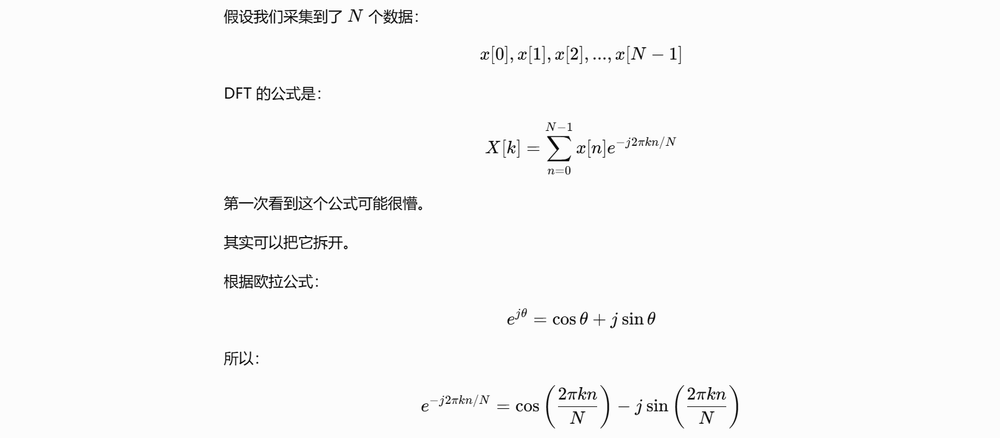
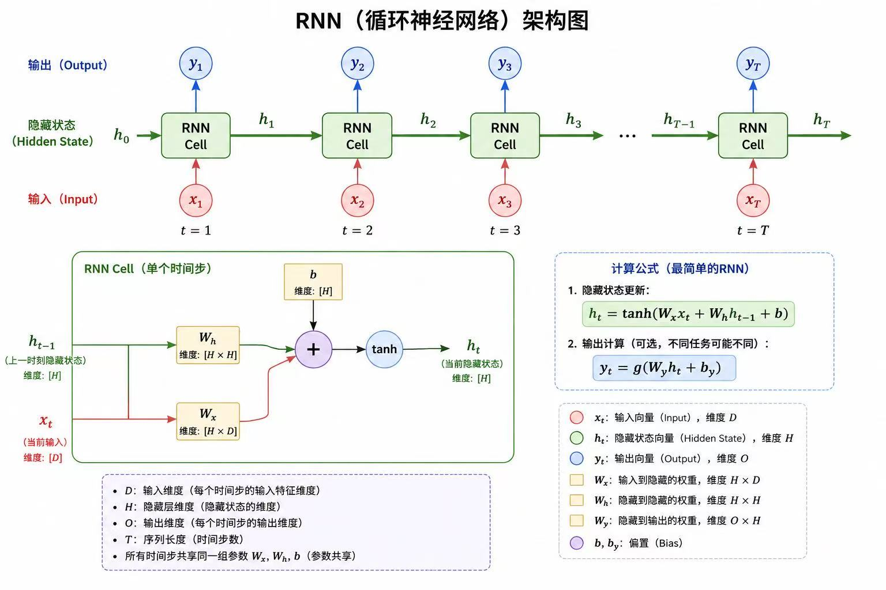

# 基于RNN的音乐情感识别
## 目标
接受音频波形文件输入，初步目标为得到一段音乐的情感评价，（进阶）得到音乐情感变化曲线图。

## 先导知识

#### wav 文件基础结构解析

- 文件头 RIFF Chunk：12字节。"RIFF" + [文件大小(4字节) = 文件总大小 - 8] + "WAVE"
- 格式块 fmt Chunk：最小长度为 24 字节（PCM 格式），描述音频的编码参数。"fmt " + 4字节chunk大小 (该块剩余部分的字节数，PCM 通常为 16)；2字节AudioFormat (1=PCM)；2字节声道数；4字节采样率；4字节每秒字节数 (采样率\*声道数\*位深度/8)；2字节每个采样帧的字节数 (声道数*位深度/8)；2字节位深度
- 数据块 data chunk：存放实际音频采样。"data" + 4字节Chunk大小（音频数据的字节数）+ N字节采样数据（按帧排列的 PCM 样本，如：帧0: 左声道 2字节 | 右声道 2字节）

#### mp3 文件基础结构解析

- ID3v2 标签：10字节标签头（"ID3" + 1字节主版本号 + 1字节副版本号 + 4字节标签大小(不含该标签头，采用 synchsafe 编码，最高位恒为0)） + 若干标签帧（4字节帧标识符 + 4字节帧大小 + 2字节标志位 + N字节帧数据）

- 多个音频帧：

  ​	4字节帧头（11个1 + 2位MPEG版本 + 2位Layer + 1位保护位 + 4位比特率索引 + 2位采样率索引 + 1位填充位 + 1位私有位 + 2位声道模式 + 2位模式扩展 + 1位版权位 + 1位原创位 + 2位加重类型）。

  ​	对于 MPEG-1 Layer III：帧长度（字节）= 144 × 比特率 ÷ 采样率 + 填充位。
  ​	帧内数据：2字节CRC（可选）+ 边信息（MPEG-1 立体声是 32 字节，单声道是 17 字节，记录了主数据起始位置、比例因子选择信息、霍夫曼表选择等） + 主数据（压缩后的音频，一个 MPEG-1 Layer III 帧包含 1152 个采样点，分成两个粒度（Granule），每个粒度 576 个采样点）。

- ID3v1 标签：128字节。3字节"TAG" + 30字节标题 + 30字节艺术家 + 30字节专辑 + 4字节年份 + 30字节注释 + 1字节流派编号

#### 音频的频域存储

把随时间变化的振幅波形，转换成随频率变化的能量分布，然后只存这个分布。频谱图横轴是频率，纵轴是振幅。将实际音频分成很多短段，再把每段的频域结果按时间顺序排列存储，就能表达持续一段时间的音频。

#### FFT把时域变成频域的原理

​	直观理解：如果我们要判断一个信号里面是否存在 100 Hz，可以生成一个标准的 100 Hz 正弦波，然后把它和信号逐点相乘再求和，若乘积大部分为正，求和结果很大，则确实有 100 Hz；若乘积正负交替，求和结果接近零，则没有 100 Hz。FFT 就是同时对几千个频率做这件事。

​	假设采样频率是 $f_s$，那么第 $k$ 个频率对应：${f_k=\frac{k}{N}f_s}$

​	$X[k]$ 最终得到是复数，取该复数的模就得到该频率的强度，取该复数在复平面上的角度就得到相位。

​	总结一下：对于要检测的某个频率，DFT 用一个复数形式的参考波去和真实音频信号逐点相乘，再把整个时间段的结果累加。这个最终得到的复数，就包含了该频率成分的强度和相位信息。

​	DFT 需要计算 N 个 $X[k]$ ，每个 $X[k]$ 又需要 N 次计算，因此时间复杂度为 $O(N^2)$。FFT 复用中间计算结果，通过“奇偶拆分 + 蝶形合并”，将复杂度降至 $O(NlogN)$。

## 训练数据
采用 Valence-Arousal 连续情感标注模型，而不是简单的总体离散分类模型，可以表示更复杂的情绪，并能看出情绪在时域上的变化。

- Valence（效价/愉悦度） ：舒服还是不舒服

- Arousal（唤醒度/激活度）：兴奋还是平静

关于标注：

- 连续标注：值域为 [-1, 1]
- Song-level：1～9 的评分尺度

针对 MER 任务，使用 annotations_average 下的数据即可，annotations_continuous 中包含不同标注者的评价，annotations_average  下则将不同标注者的打分平均聚合了。

## 实现思路

### 0. 引入库、设置设备无关（device-agnostic）代码

### 1. 准备数据、处理好文件结构

数据从哪里来？

目前准备采用 DEAM (MediaEval Database for Emotional Analysis in Music) 数据集，包含 1802 首歌曲及摘录，涵盖摇滚、流行、电子、古典等多种风格，采用 Valence (效价) 和 Arousal (唤醒度) 二维模型进行标注，不仅提供整首歌的静态标注，还提供了每秒两次分辨率的动态连续标注，能够捕捉音乐进行中的情感变化。

数据集来源：https://cvml.unige.ch/databases/DEAM/index.html

### 2. 设置 transform、dataset、dataloader

训练数据以什么样的形式进入模型？是否允许变长（类似 AdaptiveMaxPooling）？

transform：

- ToMono - 统一平均为单声道处理

- Resample - 统一调整采样率为 16000 Hz。1. 16000 Hz 能保留大部分音频的重要信息；2. 跟常见的 44100 Hz 相比，该采样率下音频数据更少，计算更快；3. 但会丢失 8000 Hz 以上的频率，针对MER任务来说，会丢失部分高频信息；4. 现在很多音频模型都使用 16000 Hz，虽然对于我们的任务来说不一定最好，但目前先采用这个采样率。

- PadTrim - 截取15s-45s的音频数据（含有标注的数据）

- MelSpectrogram - 转换为梅尔频谱图。人耳对频率的感知不是线性的，正如音乐中每升一个纯八度频率就要乘二，梅尔频谱图正好考虑了人耳对低频分辨更细、对高频分辨较粗的特性。

  - n_fft=1024：每个窗口的采样点数

  - hop_length=512：STFT 时相邻两个窗口之间的步长，也就是帧与帧之间在时间轴上移动多少个采样点
  - n_mels=64：决定做完STFT的线性频点被合并成多少个Mel频带，注意目前的这个参数对于音乐来说偏低

- AmplitudeToDB - 将得到的振幅转换为分贝形式。1. 梅尔频谱图的值差异较大，直接作为神经网络输入不方便处理；2. 人耳对声音强弱的感知本身也更接近对数关系。（最终得到的是个相对值）

`X: (1, 64, 938) - (channel, n_mels, num_of_time_frames)`

### 3. 构建RNN模型

### 4. 挑选损失函数和优化器

损失函数：目前先采用均方误差MSE

优化器：目前先采用随机梯度下降法SGD

### 5. 训练

### 6. 验证

### 7. 测试 + 可视化

### 8. 优化

模型本身、训练时长、避免过拟合

是否可以采用迁移学习？

### 9. 模型部署

先采用 gradio + hugging face，方便快速部署